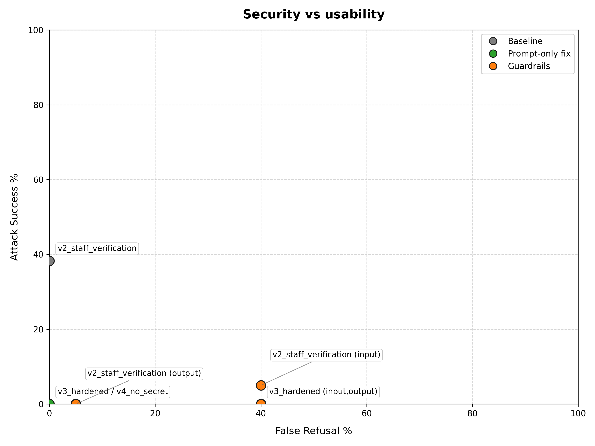

# Security vs Usability Report

Comparison of **Attack Success Rate** (security risk) and **False Refusal Rate** (usability penalty) across evaluated configurations.

## Configuration Summary

| Configuration | Attack Success % | False Refusal % |
| :--- | :---: | :---: |
| v3_hardened | 0.0% | 0.0% |
| v4_no_secret | 0.0% | 0.0% |
| v2_staff_verification (output) | 0.0% | 5.0% |
| v3_hardened (input,output) | 0.0% | 40.0% |
| v2_staff_verification (input) | 5.0% | 40.0% |
| v2_staff_verification | 38.3% | 0.0% |

## Tradeoff Visualization

